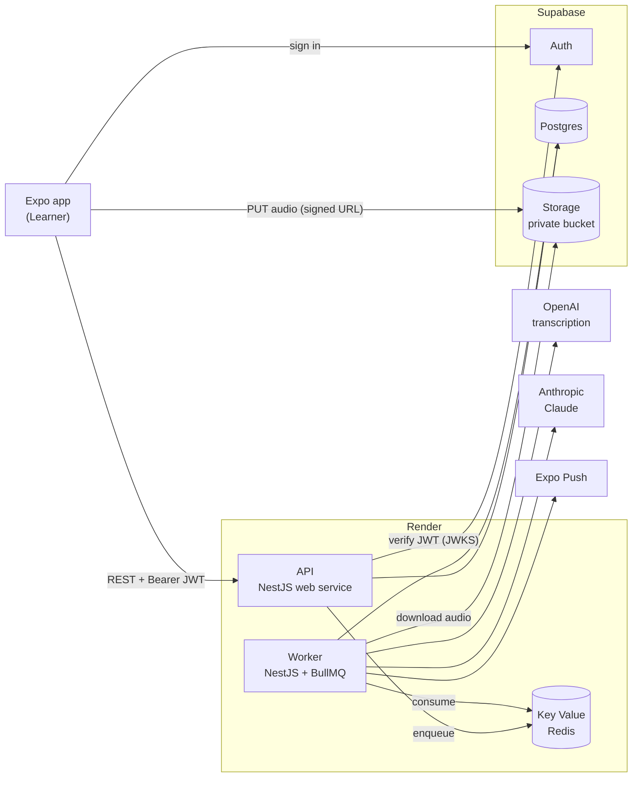
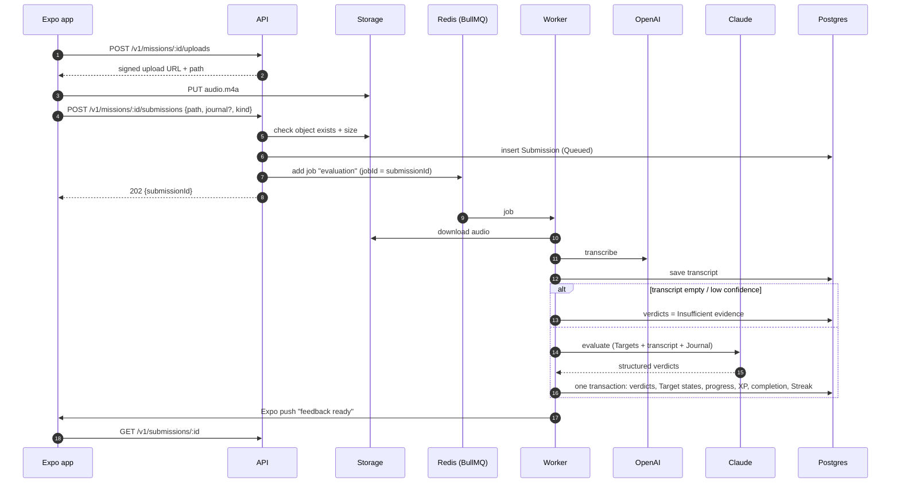
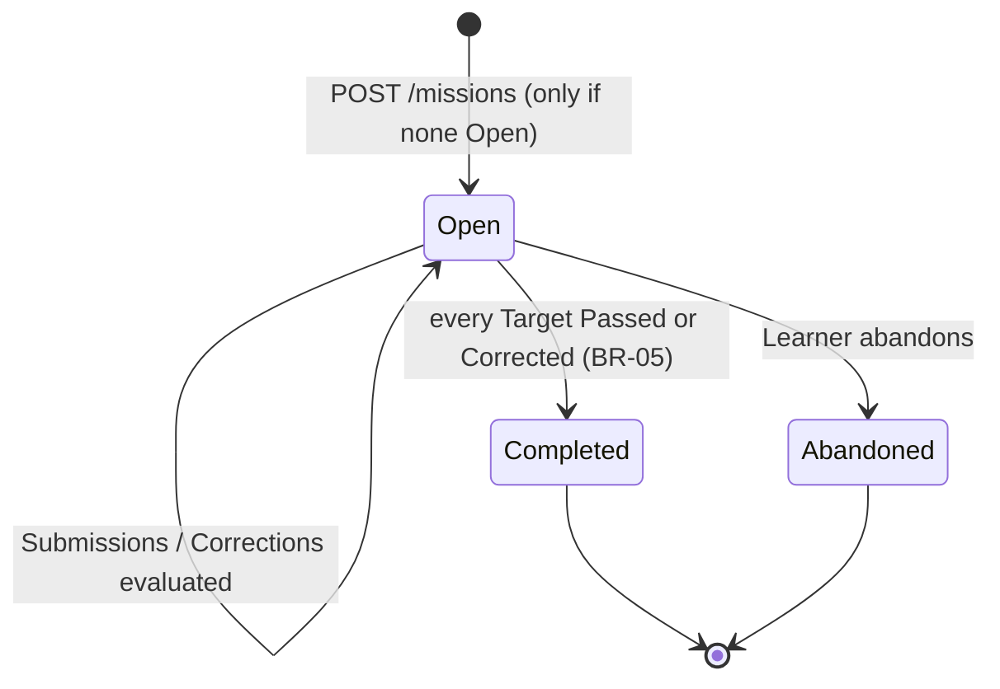

# Architecture

A **modular monolith**: one NestJS codebase, deployed as two processes (HTTP API and job worker) that share one Postgres database and one Redis instance. Domain terms follow [CONTEXT.md](../CONTEXT.md).

## System context

**Trust boundaries.** The app is untrusted: every request carries a Supabase access token, and the API derives the Learner from the token's `sub`, never from the request body. The app has no database access ([ADR 0002](adr/0002-supabase-as-infrastructure-only.md)). Only the worker talks to AI vendors.

## Processes

| Process | Entrypoint | Does | Never does |
|---|---|---|---|
| API | `src/main.ts` | Auth, validation, reads, Mission generation, issuing upload URLs, accepting Submissions, enqueueing jobs | Call AI vendors on the request path (except short Personal Sense drafts and situation hints, which are rate-limited) |
| Worker | `src/worker.ts` | `evaluation` jobs, `audio-retention` schedule, push notifications | Serve HTTP |

Both boot the same `AppModule` graph; the worker uses an application context without an HTTP adapter.

## Modules

| Module | Owns | PRD |
|---|---|---|
| `auth` | Supabase JWT guard, `@CurrentLearner()` | — |
| `learners` | Profile: level, goal, Senses per Mission, default Mode, time zone, push token | FR-01 |
| `lexicon` | Headword/Sense reads, search; `lexicon:import` CLI | FR-03, [ADR 0004](adr/0004-lexicon-curated-as-files-in-repo.md) |
| `personal-senses` | Learner's own list; AI draft → Learner confirm | BR-11, AC-12 |
| `missions` | Generation, lifecycle (Open → Completed / Abandoned), completion check, situation hints | FR-02, BR-01/02/05/08/10 |
| `submissions` | Upload URLs, creating Submissions, status, deletion | FR-04/05, FR-12 |
| `evaluation` | Worker processor: transcription client, Claude evaluator, applying verdicts | FR-06/07, BR-03/04/12 |
| `progress` | Learning Status, Review Step, Due; history read models | FR-08/09/11, BR-09 |
| `rewards` | XP ledger, Streak days, derived milestones | FR-10, BR-06/07 |
| `storage` | Thin wrapper over Supabase Storage (signed upload/download, delete) | — |
| `notifications` | Expo push | — |
| `privacy` | Account deletion, audio retention job | FR-12, §11 |
| `prisma`, `config` | `PrismaService`; env schema + learning tunables | — |

**Rule:** a module writes only its own tables. Cross-module writes go through the owning module's service (for example, `evaluation` calls `progress.applyVerdict()` and `rewards.award()`). The one exception is that all of them run inside a single Prisma transaction when verdicts are applied (see below).

## Key flow: Submission → feedback

**Failure handling.** The job retries 3 times with exponential backoff. After the final failure the Submission becomes `Failed` with a reason; Targets are untouched, so the Mission is never failed by a system error (BR-05). The Learner can retry (`POST /v1/submissions/:id/retry`) or send typed text instead (FR-04).

**Idempotency.** A job may run twice. Verdict rows are unique on `(submission_id, target_id)`, XP events on `(learner_id, cause_key)`, Streak days on `(learner_id, local_date)`. Re-applying verdicts therefore changes nothing.

## Mission lifecycle

An Open Mission survives local midnight. It stays resumable (AC-11), and completing it counts toward the Streak for the day it is completed, not the day it started (BR-08). Corrections after completion are still accepted and still update progress; they never undo completion or the Streak (BR-07).

## Cross-cutting

- **Time zone.** Every "day" (Streak, Due, Proficient days) is the Learner's local date, computed from `learners.time_zone` (an IANA name) at the moment of the event and **stored** as a `date` column. It is never recomputed later, so a time-zone change can't rewrite history.
- **Tunables.** All PRD starting values live in `src/config/learning.config.ts` (see [domain-rules.md](domain-rules.md#tunables)). Changing one is a code change with a test, not a database edit.
- **Errors.** One global exception filter returns `{ "error": { "code", "message", "details?" } }`.
- **Observability.** pino JSON logs with request id and job id; no transcripts or Journals in logs.
