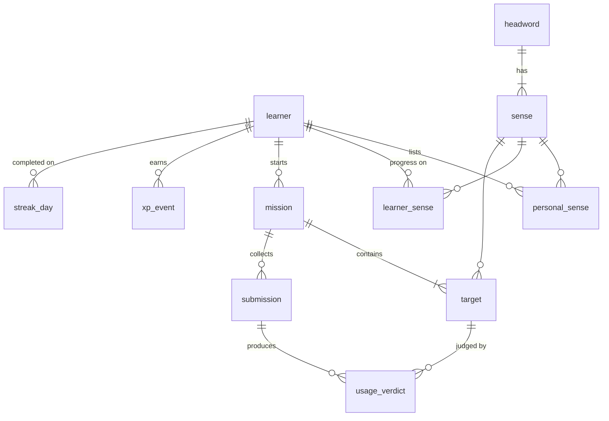

# Data model

Postgres on Supabase, accessed through Prisma. Models are PascalCase in Prisma and mapped to snake_case tables (`@@map`). IDs are UUIDs. All timestamps are `timestamptz`; every "local day" is stored as a `date` computed in the Learner's time zone at the moment of the event.

## Tables

### `learner`
| Column | Notes |
|---|---|
| `id` | = Supabase Auth user id (`sub`). Created on first authenticated request. |
| `self_assessed_level` | enum `basic` · `intermediate` · `advanced` (an estimate, never a fixed label) |
| `goal` | free text, nullable |
| `senses_per_mission` | int, default 5, CHECK between configured min and max |
| `default_mode` | enum `quick` · `daily` · `deep`, default `daily` |
| `time_zone` | IANA name, e.g. `Asia/Ho_Chi_Minh` |
| `expo_push_token` | nullable |

### `headword`, `sense`
`headword(id, text, normalized_text UNIQUE)`

| `sense` column | Notes |
|---|---|
| `headword_id` | FK |
| `origin` | enum `lexicon` · `learner` |
| `owner_learner_id` | NULL for Lexicon Senses; set for Learner-owned Senses |
| `verification` | enum `admin_curated` · `learner_confirmed` · `draft` |
| `lexicon_key` | stable key from the Lexicon file (e.g. `run.v.manage`), UNIQUE where not null |
| `part_of_speech`, `definition` | required |
| `pronunciation_ipa` | nullable; shown only when present (FR-03) |
| `examples`, `collocations` | `text[]` |
| `topic`, `difficulty`, `rank` | `difficulty` uses the level enum; `rank` orders New picks |
| `archived_at` | set when a Sense leaves the Lexicon files; never hard-deleted |

Constraints (raw SQL migration): `CHECK ((origin = 'lexicon') = (owner_learner_id IS NULL))`, `CHECK (origin = 'learner' OR verification = 'admin_curated')`.

### `personal_sense`
`(learner_id, sense_id)` PK, `added_at`. A Learner's own list. It points either at a Lexicon Sense or at a Learner-owned Sense. Only Senses whose verification is not `draft` can become Targets (BR-11).

### `learner_sense` — progress
| Column | Notes |
|---|---|
| `(learner_id, sense_id)` | PK |
| `status` | enum `new` · `learning` · `needs_practice` · `proficient` |
| `review_step` | int index into the ladder |
| `due_on` | `date` (local); NULL = not scheduled |
| `last_practised_at` | timestamptz |

A row exists once a Sense has been a Target at least once. A Lexicon Sense with no row is "New" for that Learner.

### `mission`
| Column | Notes |
|---|---|
| `learner_id`, `mode` | |
| `status` | enum `open` · `completed` · `abandoned` |
| `started_at`, `completed_at`, `abandoned_at` | |
| `completed_on` | local `date`; drives the Streak |

Constraint: `CREATE UNIQUE INDEX one_open_mission ON mission (learner_id) WHERE status = 'open'` (raw SQL; Prisma can't express partial indexes).

### `target`
| Column | Notes |
|---|---|
| `mission_id`, `sense_id` | UNIQUE `(mission_id, sense_id)`: no Sense twice in one Mission (FR-02) |
| `source` | enum `new` · `review` · `personal` |
| `position` | display order |
| `state` | enum `pending` · `passed` · `needs_correction` · `corrected` (see [domain-rules.md](domain-rules.md#target-states)) |

### `submission`
| Column | Notes |
|---|---|
| `mission_id`, `learner_id` | |
| `kind` | enum `practice` · `correction` |
| `correction_target_id` | required iff `kind = 'correction'` (CHECK) |
| `input_type` | enum `audio` · `text` |
| `audio_path` | Storage path; NULL for text input |
| `audio_deleted_at` | set by retention or deletion |
| `journal` | nullable text (FR-05) |
| `text_body` | typed fallback input |
| `transcript` | filled by the worker |
| `status` | enum `queued` · `processing` · `evaluated` · `failed` |
| `failure_reason`, `evaluated_at` | |
| `deleted_at` | tombstone: content columns nulled on Learner deletion ([privacy.md](privacy.md#deletion)) |

### `usage_verdict`
| Column | Notes |
|---|---|
| `submission_id`, `target_id`, `sense_id`, `learner_id` | UNIQUE `(submission_id, target_id)` |
| `verdict` | enum `appropriate` · `needs_improvement` · `not_used` · `insufficient_evidence` |
| `evidence_quote` | exact span from the transcript/Journal; NULL only for `not_used` / `insufficient_evidence` |
| `explanation`, `suggestion`, `next_step` | feedback text (FR-06) |
| `local_date` | Learner's local date of the Submission; used by the Proficient rule |
| `learner_rating` | nullable enum `helpful` · `not_helpful` · `wrong` (PRD metric "AI feedback usefulness") |

### `xp_event` — append-only ledger
`(id, learner_id, amount, reason, cause_key, created_at)`, UNIQUE `(learner_id, cause_key)`. Insert with `ON CONFLICT DO NOTHING`; the unique key is what enforces "no repeat rewards" (FR-10, AC-09). Total XP = `SUM(amount)`.

### `streak_day`
`(learner_id, local_date)` PK. One row per local day with at least one Completed Mission (BR-07, AC-10). The current Streak is the run of consecutive dates ending today or yesterday.

## Deliberately absent

- **Drafts** live on the device ([ADR 0005](adr/0005-drafts-live-on-device-only.md)).
- **Milestones** are derived at read time from XP, Streak and status counts. Add a table only once milestones need awarded-at state.
- **Admin users**: the Admin works through repo files and the import command ([ADR 0004](adr/0004-lexicon-curated-as-files-in-repo.md)).
- **Placement test results**: the optional assessment (PRD §4.2) is post-MVP; `self_assessed_level` covers AC-01.
